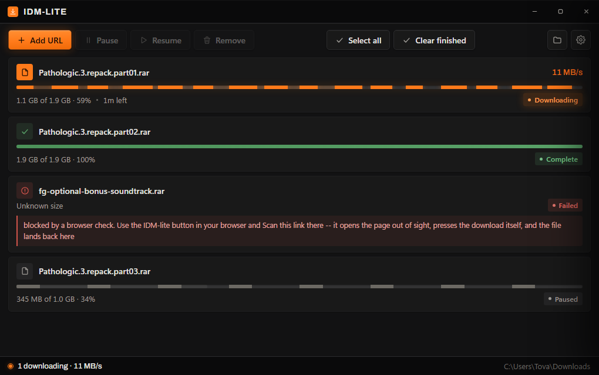
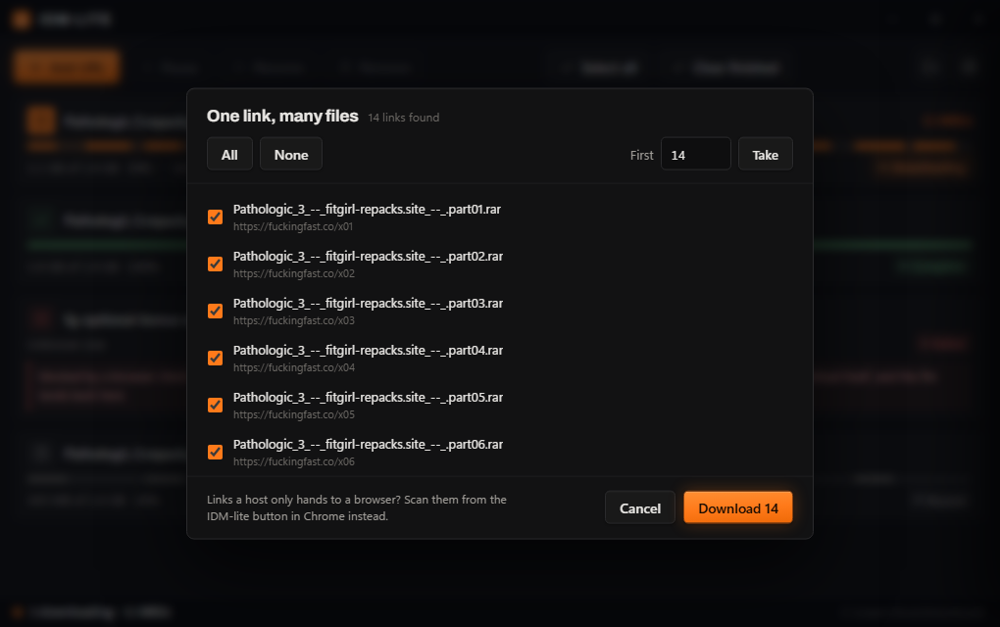
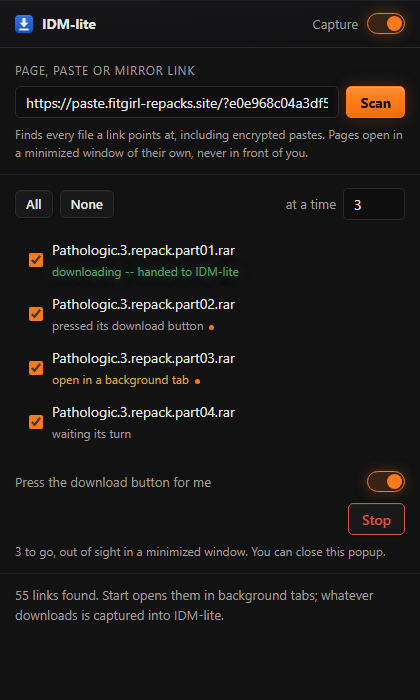
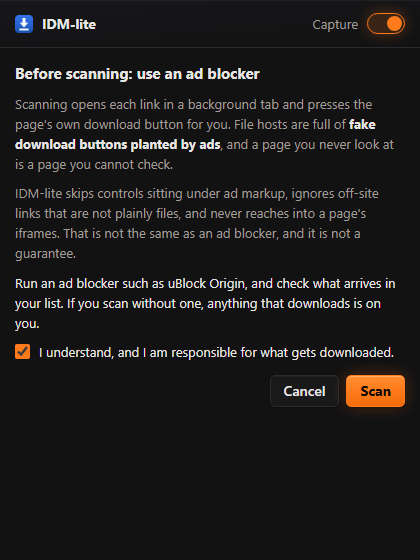

<div align="center">

# IDM-lite

**A download manager for Windows that actually finishes the file.**

Your browser fetches on one connection and gives up when it drops. IDM-lite splits the file across many connections, reconnects the ones that die, and hands you the finished thing.

[](https://github.com/tovaisme/idm-lite/releases/latest)
[](LICENSE)
[](https://github.com/tovaisme/idm-lite/releases/latest)
[](https://www.rust-lang.org)

**[tovaisme.github.io/idm-lite](https://tovaisme.github.io/idm-lite/)**



</div>

## What it does

A browser extension watches your downloads. The moment one starts, it hands the URL (plus your cookies, referer and user agent) to the app, and the app pulls the file across up to 32 connections at once.

| | Browser on its own | IDM-lite |
|---|---|---|
| Connections per file | 1 | up to 32, 16 by default |
| A connection drops | start over | that slice reconnects, the rest keep going |
| Close the app halfway | lost | resumes exactly where it stopped |
| One slow connection | everything waits for it | its work gets handed to idle connections |
| Install footprint | n/a | one 1.9 MB exe, no runtime |

## Install

Download **[IDM-lite-Setup-1.0.3.exe](https://github.com/tovaisme/idm-lite/releases/latest)** and run it. No admin rights needed, everything installs for your user only.

The installer puts the app in `%LOCALAPPDATA%\Programs\IDM-lite`, registers it with Chrome, Edge, Brave and Chromium, adds a Start menu entry, lists itself in Add or remove programs, and starts the app in your tray.

Then it opens the Extensions page for the one step it is not allowed to do for you:

```
1.  turn on  Developer mode           top right of chrome://extensions
2.  click  Load unpacked
3.  choose the extension folder       the installer opens it in Explorer
```

**Why that step is manual.** Chrome deliberately blocks installers from adding extensions. Sideloading through the registry has been disabled for off store extensions since Chrome 44, and the only ways around it are a Chrome Web Store listing or an enterprise policy that marks the whole browser as managed by an organisation. Neither belongs in a small tool like this, so the extension is loaded by hand, once.

Uninstall from Add or remove programs, or run the setup again with `/uninstall`. There is a `/silent` switch for unattended installs. Your downloaded files are never touched.

Prefer a plain folder? The zip in the same release has the exe, the extension and `Install.bat` with no installer involved. Windows 10 or 11.

## One link, many files

Paste a link that lists files rather than being one -- a mirror page, a folder index, an encrypted paste -- and IDM-lite reads it, shows you everything it found, and asks what to take.



Tick what you want, take the first N, or take the lot. Links that name a file are ticked for you; the rest of a page's navigation is not.

Pastes on [PrivateBin](https://privatebin.info) sites are read too. Those are encrypted in the browser, with the key in the part of the URL after `#` that is never sent to the server, so IDM-lite strips the key before fetching and decrypts the note locally in its own window. The server is never told what you are reading, and neither is anyone watching the connection.

A link that already names a file (`.zip`, `.rar`, `.iso`, ...) is downloaded straight away, as before. Everything lands in your download folder from Settings -- IDM-lite never asks where to put a file.

## When a link will not give up the file

Some hosts answer anything that is not a browser with a check page instead of the file. IDM-lite cannot clear those -- that is the point of them -- so it does the next best thing, by itself:

1. It tries the link directly, with the cookies, referer and user agent your browser would send.
2. If the answer is a check, a sign-in or a refusal, it **does not take the download away from your browser**. The extension only cancels a browser download once the app has accepted it, so a refusal leaves the file downloading where it already was.
3. Anything that still needs a browser can be handed to one: the extension opens the links in background tabs, a few at a time. A page that starts its own download gets captured into IDM-lite and its tab closes. A page that wants a click is left open, labelled, and the queue moves on.

The row tells you which it was -- *blocked by a browser check*, *may want a sign-in*, *rate limiting us*, *that link is gone* -- instead of `HTTP 403`.

## The extension popup



<kbd>Click the IDM-lite icon</kbd> for the browser side of it:

- **Capture** on or off, without leaving the page.
- **Scan** any page, paste or mirror link -- it starts filled in with the tab you are on.
- The list of what it found, with **All / None** and **how many tabs at a time**.
- **Start** works through them in the background. **Stop** halts it; tabs already open stay open.

Queued pages open in a **minimized window of their own**, a few at a time, so nothing appears in front of what you are doing. A page that starts its own download is captured and its tab closes itself; one that needs a press gets pressed; one that needs you is left open and labelled.

Close the popup whenever you like. The queue runs in the extension's worker, not in the popup, so it keeps going.

<br clear="all">

## Ads, and what gets pressed

Scanning presses the download button on pages you are not looking at, and file hosts are full of fake ones planted by ads. The first time you scan, IDM-lite says so and asks you to accept that before it will do it.

It is not only a warning. The clicker skips any control sitting under ad-shaped markup, ignores a link that leaves the site unless it plainly names a file, and only ever runs in the page's top frame, so the iframes ads usually live in are out of reach. Anything it is unsure about it leaves for you.

None of that replaces an ad blocker. Run one.



## If Windows Defender flags it

A new, unsigned executable that installs itself, writes an uninstall entry and then downloads files for a living is the exact shape of a dropper, so Defender's machine-learning model sometimes scores it as one. 1.0.2 was flagged as `Trojan:Win32/Bearfoos.A!ml` on a clean machine. The `!ml` suffix means a heuristic guess, not a signature match on known malware.

1.0.3 removes the two behaviours that earned most of that score:

| Was | Now |
|---|---|
| `powershell.exe -Command (New-Object -ComObject WScript.Shell).CreateShortcut(...)` to make the Start Menu entry | the shell's `IShellLink` COM interface, in process, spawning nothing |
| `powershell.exe Start-Sleep; Remove-Item -Recurse` to delete itself after uninstall | `MoveFileEx(..., DELAY_UNTIL_REBOOT)`, which is what Windows provides for it |
| the installer launching `explorer` and `cmd /c start chrome://extensions` at the end | the paths printed for you to open |

The installer now spawns no shell at all. What it still does, and will keep doing, is write `HKCU\...\Uninstall\IDM-lite` so it appears in Add or remove programs, write the native messaging keys so your browser can reach it, and drop two executables in `%LOCALAPPDATA%\Programs\IDM-lite`. That is what installing is.

**The only thing that removes heuristic flags for good is a code signing certificate**, which costs money and builds reputation over time. Until this project has one, a new release can be flagged again. If it happens:

1. Check the file against the hashes published with the release (`SHA256SUMS.txt`), or build it yourself with `python tools/package.py` and compare.
2. Report it to Microsoft as a false positive at [microsoft.com/wdsi/filesubmission](https://www.microsoft.com/en-us/wdsi/filesubmission) — that is what actually clears it, for everyone.
3. Only then, if you want it running meanwhile, exclude the install folder in Windows Security. Do that deliberately, not as a habit.

Every release is built from this repository by `tools/package.py`, which also refuses to ship a binary carrying any path from the machine that built it.

## Updating

Run `update.exe` from the install folder. It asks GitHub for the newest release, and if there is one, downloads that installer and runs it. `update.exe --check` looks without installing.

## It stays out of your way


IDM-lite lives in the tray. Closing the window hides it and the downloads carry on. A captured download brings it back in about 36 ms, because the app is already running.

## Why it is fast

Most of the speed in a segmented downloader does not come from the number of connections. It comes from what happens when one of them is slow.

Split a file into eight equal pieces and the slowest connection decides when you finish, while seven sit idle at the end. IDM-lite re splits instead. A connection that runs out of work takes the back half of whichever slice has the most left, again and again, down to 512 KiB.

On a benchmark where one slice is deliberately throttled:

```
fixed segments      1449 ms
IDM-lite             445 ms      about 3.2x faster
```

Run it yourself with `cargo test -- --ignored --nocapture`.

The rest of it: one pooled HTTP agent per download so re splitting never pays for a fresh TLS handshake, a slice that drops reconnects with backoff instead of failing the file, and the probe that resolves the filename is reused rather than requested twice.

None of this invents bandwidth. Against one fast server with no stragglers it ties a good downloader rather than beating it. The gains show up on flaky links and on servers that throttle each connection.

## How it fits together

```
Chrome starts a download
   |   the extension forwards url, cookies, referer, user agent
   v
IDM-lite.exe chrome-extension://...      native messaging host, a thin stub
   |   loopback TCP guarded by a token, starts the app if it is not running
   v
IDM-lite.exe                             the app, its own process
   +-- segmented engine  ->  your downloads folder
```

The app is a separate process from the browser, so closing the browser never interrupts a transfer. The extension hands a download over *before* cancelling it in Chrome, so if the app cannot be reached your browser simply keeps the download.

## Build it yourself

Rust (stable, MSVC) and Python 3 for the packaging helpers.

```bash
cargo build --release          # target/release/IDM-lite.exe
python tools/package.py        # dist/ with the exe, extension and installers
python tools/make_icons.py     # regenerate icon.ico and the extension PNGs
```

`tools/package.py` is what builds a release. It remaps source paths so the published binary carries nothing about the machine that built it, and it refuses to package if it finds one.

## Tests

```bash
cargo test                                     # 21 tests
cargo test -- --ignored --nocapture            # the straggler benchmark
python tests/smoke.py                          # end to end against the built exe
node tests/capture_guard.mjs                   # the extension: capture guard and the tab queue
node tests/scrape.mjs                          # reading links out of pages and encrypted pastes
node tests/clicker.mjs                         # what gets pressed, and what is left alone
```

The engine is tested against a real local HTTP server, not mocks: parallel integrity, resume offsets, rejecting stale resume data, servers with no range support, connections dropped mid transfer, slow slice takeover and filename collisions. `tests/smoke.py` drives the built exe the way a browser does, sending a real native messaging frame and checking the file, cookies, persistence and registration. It restores your own registration afterwards.

## Layout

| Path | What it does |
|------|--------------|
| `src/download.rs` | the engine: slices, re splitting, retry, resume sidecar |
| `src/main.rs` | modes (app, host, register), config, state, loopback IPC |
| `src/ui.rs` | frameless window plus WebView2, state push, command handling |
| `src/ui.html` | the interface |
| `src/bin/update.rs` | the updater: asks GitHub for a newer release and installs it |
| `extension/` | the MV3 extension, with a pinned ID |
| `extension/popup.*` | the browser-side UI: capture, scan, the queue |
| `extension/scrape.js` | reading links out of a page or paste, shared with the window |
| `docs/` | the site at [tovaisme.github.io/idm-lite](https://tovaisme.github.io/idm-lite/) |

Settings and the download list live in `%LOCALAPPDATA%\IDM-lite`. Set `IDMLITE_DATA` to move them, which is how the tests stay out of your real state.

## Good to know

* `blob:` and `data:` downloads stay with the browser, because another process cannot refetch them.
* A server without `Accept-Ranges` falls back to one connection and cannot resume.
* The loopback port checks a token, so a web page cannot queue downloads on your machine.
* The extension ID is pinned by the public key in its manifest, which is why setup needs no copy and paste step.

## About this project

IDM-lite is an independent program. It takes its shape from how Internet Download Manager is put together, meaning a browser extension that captures downloads paired with a native app that performs them, but it is not affiliated with IDM, it is not a clone of it, and it contains none of its code. Everything here was written from scratch against public specifications: HTTP range requests (RFC 9110), the Chrome extension APIs and Chrome native messaging.

Issues and pull requests are welcome.

## Licence

MIT, see [LICENSE](LICENSE).

The interface embeds the Archivo typeface by Omnibus Type under the SIL Open Font License 1.1, included at [assets/Archivo-OFL.txt](assets/Archivo-OFL.txt).
