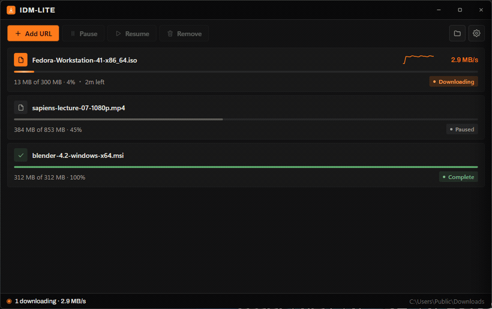
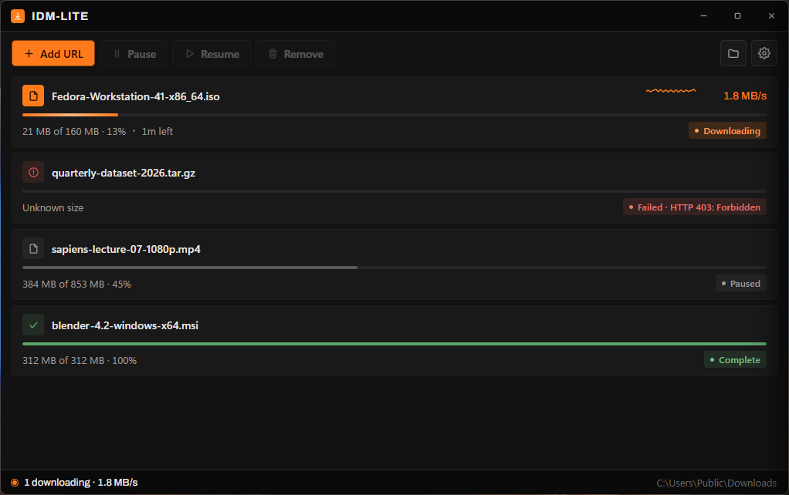
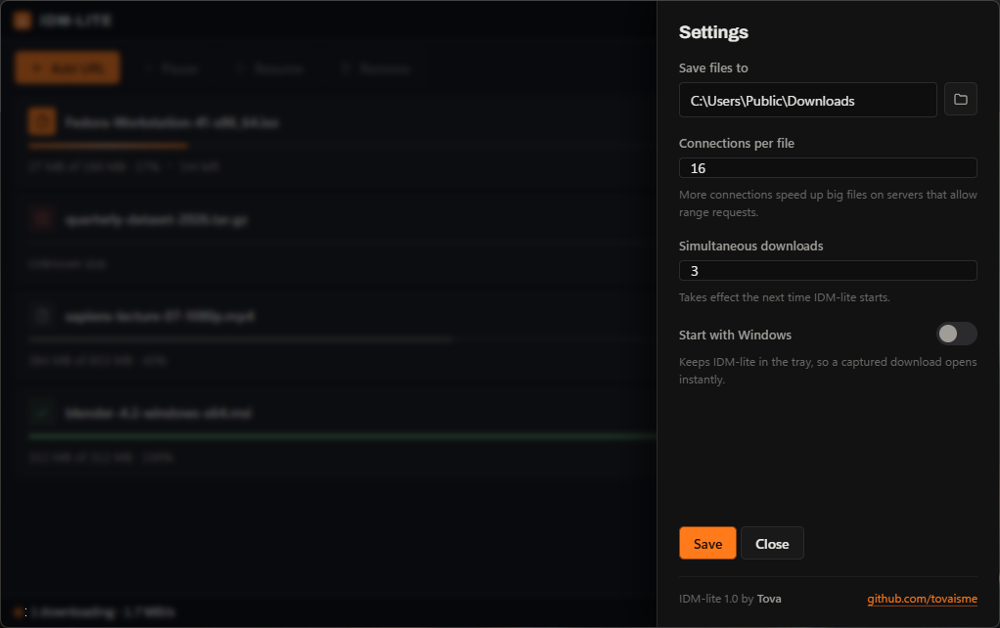

<div align="center">

# IDM-lite

**A download manager for Windows that actually finishes the file.**

Your browser fetches on one connection and gives up when it drops. IDM-lite splits the file across many connections, reconnects the ones that die, and hands you the finished thing.

[](https://github.com/tovaisme/idm-lite/releases/latest)
[](LICENSE)
[](https://github.com/tovaisme/idm-lite/releases/latest)
[](https://www.rust-lang.org)



</div>

## What it does

A browser extension watches your downloads. The moment one starts, it hands the URL (plus your cookies, referer and user agent) to the app, and the app pulls the file across up to 32 connections at once.

| | Browser on its own | IDM-lite |
|---|---|---|
| Connections per file | 1 | up to 32, 16 by default |
| A connection drops | start over | that slice reconnects, the rest keep going |
| Close the app halfway | lost | resumes exactly where it stopped |
| One slow connection | everything waits for it | its work gets handed to idle connections |
| Install footprint | n/a | one 1.9 MB exe, no runtime |

## Install

Download **[IDM-lite-Setup-1.0.0.exe](https://github.com/tovaisme/idm-lite/releases/latest)** and run it. No admin rights needed, everything installs for your user only.

The installer puts the app in `%LOCALAPPDATA%\Programs\IDM-lite`, registers it with Chrome, Edge, Brave and Chromium, adds a Start menu entry, lists itself in Add or remove programs, and starts the app in your tray.

Then it opens the Extensions page for the one step it is not allowed to do for you:

```
1.  turn on  Developer mode           top right of chrome://extensions
2.  click  Load unpacked
3.  choose the extension folder       the installer opens it in Explorer
```

**Why that step is manual.** Chrome deliberately blocks installers from adding extensions. Sideloading through the registry has been disabled for off store extensions since Chrome 44, and the only ways around it are a Chrome Web Store listing or an enterprise policy that marks the whole browser as managed by an organisation. Neither belongs in a small tool like this, so the extension is loaded by hand, once.

Uninstall from Add or remove programs, or run the setup again with `/uninstall`. There is a `/silent` switch for unattended installs. Your downloaded files are never touched.

Prefer a plain folder? The zip in the same release has the exe, the extension and `Install.bat` with no installer involved. Windows 10 or 11.

## It stays out of your way

 

IDM-lite lives in the tray. Closing the window hides it and the downloads carry on. A captured download brings it back in about 36 ms, because the app is already running.

## Why it is fast

Most of the speed in a segmented downloader does not come from the number of connections. It comes from what happens when one of them is slow.

Split a file into eight equal pieces and the slowest connection decides when you finish, while seven sit idle at the end. IDM-lite re splits instead. A connection that runs out of work takes the back half of whichever slice has the most left, again and again, down to 512 KiB.

On a benchmark where one slice is deliberately throttled:

```
fixed segments      1449 ms
IDM-lite             445 ms      about 3.2x faster
```

Run it yourself with `cargo test -- --ignored --nocapture`.

The rest of it: one pooled HTTP agent per download so re splitting never pays for a fresh TLS handshake, a slice that drops reconnects with backoff instead of failing the file, and the probe that resolves the filename is reused rather than requested twice.

None of this invents bandwidth. Against one fast server with no stragglers it ties a good downloader rather than beating it. The gains show up on flaky links and on servers that throttle each connection.

## How it fits together

```
Chrome starts a download
   |   the extension forwards url, cookies, referer, user agent
   v
IDM-lite.exe chrome-extension://...      native messaging host, a thin stub
   |   loopback TCP guarded by a token, starts the app if it is not running
   v
IDM-lite.exe                             the app, its own process
   +-- segmented engine  ->  your downloads folder
```

The app is a separate process from the browser, so closing the browser never interrupts a transfer. The extension hands a download over *before* cancelling it in Chrome, so if the app cannot be reached your browser simply keeps the download.

## Build it yourself

Rust (stable, MSVC) and Python 3 for the packaging helpers.

```bash
cargo build --release          # target/release/IDM-lite.exe
python tools/package.py        # dist/ with the exe, extension and installers
python tools/make_icons.py     # regenerate icon.ico and the extension PNGs
```

`tools/package.py` is what builds a release. It remaps source paths so the published binary carries nothing about the machine that built it, and it refuses to package if it finds one.

## Tests

```bash
cargo test                                     # 17 tests
cargo test -- --ignored --nocapture            # the straggler benchmark
python tests/smoke.py                          # end to end against the built exe
```

The engine is tested against a real local HTTP server, not mocks: parallel integrity, resume offsets, rejecting stale resume data, servers with no range support, connections dropped mid transfer, slow slice takeover and filename collisions. `tests/smoke.py` drives the built exe the way a browser does, sending a real native messaging frame and checking the file, cookies, persistence and registration. It restores your own registration afterwards.

## Layout

| Path | What it does |
|------|--------------|
| `src/download.rs` | the engine: slices, re splitting, retry, resume sidecar |
| `src/main.rs` | modes (app, host, register), config, state, loopback IPC |
| `src/ui.rs` | frameless window plus WebView2, state push, command handling |
| `src/ui.html` | the interface |
| `extension/` | the MV3 extension, with a pinned ID |

Settings and the download list live in `%LOCALAPPDATA%\IDM-lite`. Set `IDMLITE_DATA` to move them, which is how the tests stay out of your real state.

## Good to know

* `blob:` and `data:` downloads stay with the browser, because another process cannot refetch them.
* A server without `Accept-Ranges` falls back to one connection and cannot resume.
* The loopback port checks a token, so a web page cannot queue downloads on your machine.
* The extension ID is pinned by the public key in its manifest, which is why setup needs no copy and paste step.

## About this project

IDM-lite is an independent program. It takes its shape from how Internet Download Manager is put together, meaning a browser extension that captures downloads paired with a native app that performs them, but it is not affiliated with IDM, it is not a clone of it, and it contains none of its code. Everything here was written from scratch against public specifications: HTTP range requests (RFC 9110), the Chrome extension APIs and Chrome native messaging.

Issues and pull requests are welcome.

## Licence

MIT, see [LICENSE](LICENSE).

The interface embeds the Archivo typeface by Omnibus Type under the SIL Open Font License 1.1, included at [assets/Archivo-OFL.txt](assets/Archivo-OFL.txt).
